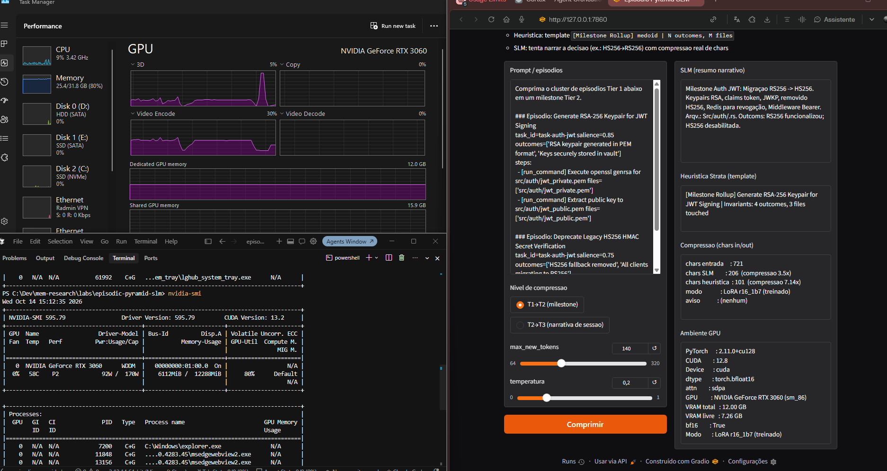

# Episodic Pyramid SLM

Small Language Model local (SmolLM2) treinado com LoRA para **comprimir memória episódica hierárquica**: traces Tier 1 → milestones Tier 2 → narrativa de sessão Tier 3.

| | |
|---|---|
| **Modelo** | `HuggingFaceTB/SmolLM2-1.7B-Instruct` + LoRA (`r=16`, lr=`1e-4`, 3 epochs) |
| **GPU** | NVIDIA GeForce RTX 3060 12 GB (CUDA / PyTorch `cu128`, bf16) |
| **Problema** | Sumarização de clusters episódicos (Auth JWT, SQLite pool, CDC outbox) |
| **Frontend** | Gradio — `python app.py` |

### Integrantes

| Nome | RM |
|------|-----|
| Pedro Farath | 98608 |
| Juliana Maita | 99224 |
| João Victor Morais | 550453 |
| Luana Cabezaolias | 99320 |
| Lucca Vilaça | 551538 |

```
Tier 1 (traces)  -->  Tier 2 (milestones)  -->  Tier 3 (narrativa de sessão)
```

O rollup heurístico de referência usa o template  
`[Milestone Rollup] <medoid> | N outcomes, M files`.  
O SLM gera o resumo narrativo (ex.: migração HS256→RS256).

---

## Estrutura

```
app.py              # frontend Gradio
train_lora.py       # treinamento LoRA
config.py           # hiperparâmetros e paths
utils.py            # carga/geração/VRAM
compressao.py       # heurística + SLM + métricas
data/               # datasets sintéticos e gabarito
runs/               # adapters e resultados
scripts/            # geração de dados, baseline, avaliação, bake-off
docs/prints/        # evidências de GPU e execução
```

---

## Setup

```powershell
python -m venv .venv
.\.venv\Scripts\activate
pip install -U pip
pip install torch --index-url https://download.pytorch.org/whl/cu128
pip install -r requirements.txt
python scripts/smoke_test.py
```

---

## Treino e inferência

```powershell
python scripts/generate_synthetic.py

python train_lora.py --tag r16_1b7 `
  --modelo HuggingFaceTB/SmolLM2-1.7B-Instruct `
  --r 16 --lr 1e-4 --epochs 3 --include-t23

python app.py
# http://127.0.0.1:7860
```

Avaliação / comparação:

```powershell
python scripts/baseline.py
python scripts/evaluate.py --tag r16_1b7 --nome lora_r16_1b7
python scripts/bakeoff.py
```

---

## Dados

Gerados por `scripts/generate_synthetic.py` (3 clusters):

| Arquivo | Conteúdo |
|---------|----------|
| `data/episodes_t1.jsonl` | Episódios Tier 1 |
| `data/sft_t1_to_t2.jsonl` | Pares SFT compressão milestone |
| `data/sft_t2_to_t3.jsonl` | Pares SFT narrativa de sessão |
| `data/gabarito.json` | Avaliação held-out (factual / síntese / armadilha) |

---

## Resultados

### Hiperparâmetros testados (GPU)

| tag | modelo | r | lr | epochs | T2→T3 | train loss |
|-----|--------|---|----|--------|-------|------------|
| baseline | 360M Instruct | — | — | — | — | — |
| default | 360M LoRA | 16 | 2e-4 | 2 | sim | 2.32 |
| r8_lr1e4 | 360M LoRA | 8 | 1e-4 | 3 | não | 2.21 |
| r16_t23 | 360M LoRA | 16 | 2e-4 | 6 | sim | 1.73 |
| r16_1b7 | **1.7B LoRA** | 16 | 1e-4 | 3 | sim | 1.85 |

### Avaliação no gabarito (12 itens held-out)

Métricas por palavras-chave / abstenção (`scripts/evaluate.py`):

| rota | acerto geral | factual | síntese | abstenção OK |
|------|--------------|---------|---------|--------------|
| baseline | 33.3% | 60% | 25% | 0% |
| default | 25.0% | 40% | 25% | 0% |
| r8_lr1e4 | 25.0% | 40% | 25% | 0% |
| **r16_t23** | **50.0%** | **80%** | **50%** | 0% |
| r16_1b7 | 33.3% | 40% | 50% | 0% |

Melhor no gabarito automático: `r16_t23` (360M). O `r16_1b7` é o usado no Gradio (melhor prosa / compressão narrativa com few-shot). Abstenção permanece 0% — o fine-tune favorece responder sempre (mesmo padrão observado na disciplina).

### Compressão no frontend

Exemplo Auth JWT: ~721 → ~200 caracteres (**~3.5×**) no SLM; heurística ~7× (mais curta, sem narrativa).  
Adapter principal: `runs/lora_r16_1b7/` · JSON: `runs/resultados/` · gráfico: `runs/bakeoff.png`

### Evidências




